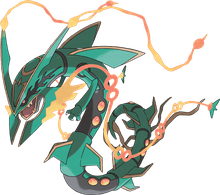
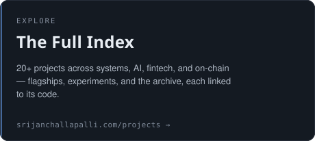

  

  
  &nbsp;
  
  &nbsp;
  

 

I'm an **AI student at Purdue** drawn to the infrastructure that makes everything else run — storage engines, distributed systems, and AI at scale. I like going low, and shipping real products people use along the way.

 

- Building an **M&A due-diligence pipeline** at **MergeWorks** — messy financial packets → source-cited, audit-ready analysis, with all arithmetic in a deterministic sandbox, not the model
- Building an **[on-chain prediction market](https://srijanchallapalli.com/)** — Ethereum testnet with ERC-20 outcome shares, collateral-backed trading, settlement, and a Postgres event indexer
- Shipped **ChitYap** to **350+ users** — a privacy-first social accountability iOS app, built and scaled end to end
- Exploring **distributed systems, AI infrastructure, and on-chain / DeFi**

 

  

<!-- Snake contribution animation (generated by the GitHub Action in .github/workflows/snake.yml) -->

  

 

  

 

  

  SYSTEMS &nbsp;·&nbsp; DISTRIBUTED COMPUTING &nbsp;·&nbsp; AI INFRASTRUCTURE &nbsp;·&nbsp; BACKEND ENGINEERING

